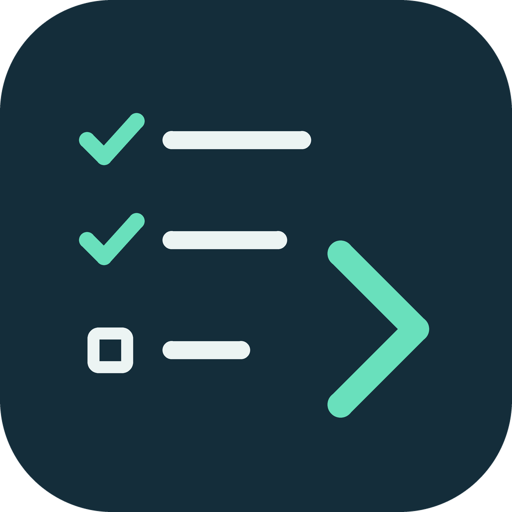

<p align="center"></p>

<h1 align="center">next-steps-plus</h1>

<p align="center"><b>Pick many. Tab once.</b><br>
After each answer, Claude Code suggests your next prompts. Tick several, press Tab, and they land in your prompt box as one numbered list, ready to edit and send.</p>

https://github.com/user-attachments/assets/e85061d4-6110-4480-b0a1-1e4bd418e54d

```
/plugin install next-steps-plus --marketplace TeeratP/next-steps-plus
```

<sub>For the Claude Code terminal (the CLI). Built on <a href="https://github.com/anthropics/claude-plugins-community/tree/main/next-steps">next-steps</a> by Thariq Shihipar. The plugin never sends a prompt on its own.</sub>

## What it adds to next-steps

| | next-steps | **next-steps-plus** |
| --- | --- | --- |
| Suggestions | 3, always | up to 7, only the ones that matter |
| Pick | one | **several**, written in the order you tick them |
| Tab | takes the top suggestion | **takes your picks** (the ghost text follows them) |
| (Recommended) | – | marks the steps worth doing now; `8` selects them all |
| Nothing to do? | – | says so ("wait for the CI run to finish") |
| Settings | a few, in `/config` | more of them, plus a pane with a live preview: `/next-steps-plus` |

Want the original behaviour? Set `selectMode` to `single` and `maxSuggestions` to `3`.

## Highlights

- **Pick several, send one prompt.** Tick suggestions with the number keys, press Tab or `9`, and they become one numbered draft.
- **(Recommended) marks what's worth doing now,** one step or several, and `8` selects them all in one press.
- **Only what matters.** From none to 5 steps, never a padded list, and when the move is to wait for CI or a build, it says so instead of inventing work.
- **Knows your skills.** A suggestion can be one of your own slash commands or skills (`/code-review high`); ones you don't have are dropped.
- **Tune everything, live.** `/next-steps-plus` explains every setting and previews your suggestion list as you change it: longer labels, the full prompt as the label, prompt style, and more.

## Good to know

- **Where it works:** the **Claude Code terminal (the CLI)** only. It doesn't work in the desktop app, VS Code or on mobile.
- **What it costs:** each list is one short extra request, a quick question to a fork of your session that reuses its prompt cache, so about one short reply. It's asked only after the answer is done, and only after answers of at least 80 characters (`minAnswerChars`).
- **Safe:** suggestion text is cleaned of terminal escape codes and invisible characters before it's shown or written, and nothing is ever sent for you.
- **Fits the screen:** suggestions that don't fit above the prompt box are left off, with a count.
- **Your settings survive updates,** including settings renamed in a later version.
- **What it changes:** only its own settings (the `next-steps-plus.*` rows in `/config`), and only when you change one in the `/next-steps-plus` pane, or when an update carries a setting you saved under an older name to its new name. It changes no other configuration and no environment variables.
- **What it hooks:** the end of each answer (to ask for suggestions), the space above the prompt box (to draw them), the start of a session or turn (to register `/next-steps-plus` and carry renamed settings), and its own settings pane: the `/next-steps-plus` command, plus the pane's focus, close and drawing. The focus hook only follows the ring between the pane's own rows; it never acts on another plugin's focus.

## Install

At the prompt of a terminal session:

```
/plugin install next-steps-plus --marketplace TeeratP/next-steps-plus
```

Answer `y` to add the marketplace, then pick a scope (user is first). The install screen then shows the settings; you can skip them all, since each title shows its default.

From a shell instead:

```
claude plugin install next-steps-plus --marketplace TeeratP/next-steps-plus
```

To update later without restarting: run `claude plugin marketplace update next-steps-plus && claude plugin update next-steps-plus@next-steps-plus`, then `/reload-plugins`. Updates keep your settings, and a setting saved under an older name is carried over to its new name (it never replaces a value you already set).

If you have the original next-steps installed, turn it off (`/plugin` → next-steps → Disable), or you will see two suggestion lists.

## Picking several suggestions

This is the default (`selectMode: multi`). Each number key ticks or unticks a suggestion, and `9` (or Tab, see below) puts all the ticked ones in the prompt box together:

```
next: type numbers to pick, Tab or 9 to use them, 0 to dismiss
  1: [2] Run the tests and fix failures
  2: [ ] Update the README for the new option
  3: [1] Commit the change
  4: [ ] /code-review high (runs alone)
  8: select all except commands   Tab/9: use selected (2)   0: dismiss
```

The number in brackets is the order you ticked them in, and that is the order they are written in. Here, pressing `3`, then `1`, then `9` writes:

```
Do these tasks:
1. Commit the change with a short message describing the new option.
2. Run the unit tests in tests/ and fix any failure, then re-run until green.
```

- `8` ticks the suggestions marked (Recommended) (or, with `eightPicks: all`, every suggestion except slash commands); press it again to untick them. (That's why there are at most 7 suggestions.)
- **Tab** works like `9`: the faint ghost text in the empty prompt box always follows your ticks (the recommended suggestion with nothing ticked, that one with one ticked, the numbered draft with several), so Claude Code's own Tab takes exactly that. It needs the plugin's `ghostText` setting on; with it off, the list says only `9`.
- A slash command (`/code-review high`) can only be used on its own, because anything after it would be read as its arguments. Ticking it unticks the others, and ticking anything else unticks it.

When the right move is to wait (CI, a build, a deploy, someone's reply) and there's nothing useful to type meanwhile, it says so instead, with nothing to pick:

```
next: nothing to do now, wait for the CI run to finish   0: dismiss
```

## Settings

Change them on the install screen, in `/config`, or in the plugin's own settings pane: type `/next-steps-plus`. A change takes effect right away, and all three show and change the same values.

<details>
<summary><b>The settings pane, key by key</b></summary>

The settings pane has three parts: every setting with its value on top; the selected setting in the middle (its description, current value, default, and where to change it); and at the bottom a preview of the suggestion list as your settings draw it, using sample suggestions.

```
──────────────────────────────────────────────────────────────
Settings
  Selection mode                     multi
  Key 8 picks                        recommended
▸ Max suggestions                    5
  Option mode                        up-to
  Label length                       48
  …
──────────────────────────────────────────────────────────────
Max suggestions
Show at most this many suggestions (1-7; in multi mode 8 picks
all, 9 uses the picks, 0 dismisses). Option mode decides
whether the list may be shorter.
Now: 5 · Default: 5 (the original next-steps used 3)

Enter: edit in the box below
                  ╭──────────────────╮
Max suggestions:  │ 5                │
                  ╰──────────────────╯
──────────────────────────────────────────────────────────────
Preview (sample suggestions with your settings; up-to often shows fewer)

next: type numbers to pick, Tab or 9 to use them, 0 to dismiss
  1: [ ] Run the tests
  2: [ ] Commit the change (Recommended)
  3: [ ] Review the diff (runs alone)
  4: [ ] Update the README
  5: [ ] Open a pull request
  8: select recommended   Tab/9: use selected   0: dismiss

╭──────────────────────────────────────────────────────────╮
│ > Commit the change with a short message describing it.  │
╰──────────────────────────────────────────────────────────╯
  ↑ your prompt box: faint ghost text, Tab accepts it

↑↓ move · Enter change · Esc close
```

- ↑↓ (or Tab) moves between settings.
- Enter turns a switch on or off, or steps a choice to its next option. For a number or text, Enter puts the cursor in the box below: type the value and press Enter to save.
- Numbers are checked before they're saved: a value that isn't a whole number in the setting's range (Max suggestions: 1–7) stays in the box with the reason in red, and nothing changes.
- On a choice, a digit picks an option directly (`1: label  2: label+prompt  3: prompt`); ✓ marks the current one.
- After each change the pane keeps the keyboard and stays on the same setting.
- While the cursor is in a box, the box is framed in the accent colour and the setting's row in the list says `editing below ↓`; it shows the value again once you save or move back up.
- Esc in a box goes back to the list without saving; Esc on the list closes the pane.
- The preview at the bottom changes as soon as you change a setting.
- If the pane opens while the prompt box has text, your keys stay in the prompt (the pane says so at the bottom). Press ctrl+x, then Tab, to move them to the pane; Esc hands them back.

The pane opens beside the conversation in a wide terminal, or above the prompt otherwise. Long values are shortened with … in the list; the full value shows below as Now.

</details>

<details>
<summary><b>All settings and their defaults</b></summary>

| Setting | Default | What it does |
| --- | --- | --- |
| `selectMode` | `multi` (original: `single`) | `multi`: pick several, as [above](#picking-several-suggestions). `single`: a number key puts that one suggestion in the prompt box |
| `eightPicks` | `recommended` | `multi` only: what `8` picks. `recommended`: the suggestions marked (Recommended). `all`: every suggestion except slash commands |
| `maxSuggestions` | `5` (original: `3`) | The most suggestions to show, 1–7 (in multi mode `8` picks all, `9` uses the picks, `0` dismisses) |
| `optionMode` | `up-to` | How many options to list. `up-to`: only the next steps that clearly matter, from none up to `maxSuggestions`, with no filler; you may see just one. `exactly`: always fill every slot |
| `labelChars` | `48`\* | Longest suggestion label, 20–300 characters |
| `promptChars` | `600`\* | Longest suggested prompt, 200–4000 characters |
| `display` | `label`\* | What each suggestion shows. `label`: a short label. `label+prompt`: the label, with its full prompt dimmed under it. `prompt`: the full prompt itself, so you see exactly what you pick (the model then writes no labels). Long prompts take more rows; any that don't fit are left off the end |
| `promptStyle` | `standard`\* | How long the suggested prompts are. `standard`: no guidance. `detailed`: 1–3 sentences saying what to do, where, and what done looks like. `brief`: one short sentence. With `display: prompt`, `standard` or `brief` fits more suggestions |
| `combineHeader` | `Do these tasks:` | `multi` only: the line above the list when several are picked; leave empty for none |
| `extraInstructions` | none | Your own wishes for the suggestions, e.g. `write prompts in Thai` |
| `ghostText` | on\* | Also show the top suggestion as faint text in the empty prompt box; Tab takes it (in multi mode, it follows your picks) |
| `markRecommended` | on | Put (Recommended) after each step the model would advise now (there can be more than one); ghost text offers the first, and `8` can select them all |
| `suggestSkills` | on\* | Let suggestions be your skills and slash commands |
| `minAnswerChars` | `80`\* | No suggestions after answers shorter than this many characters |

\* Same as the original next-steps. Settings marked "original:" exist in the original with a different default; the rest are new in this plugin.

</details>

## Credits

A fork of [next-steps](https://github.com/anthropics/claude-plugins-community/tree/main/next-steps) by Thariq Shihipar (MIT), from [anthropics/claude-plugins-community](https://github.com/anthropics/claude-plugins-community) at commit `f60f045`. The way suggestions are made is the original's; this plugin adds multi-select, Tab for your picks, (Recommended), knowing when to wait, more settings and the settings pane.

## Changelog

See [CHANGELOG.md](CHANGELOG.md).

## License

MIT, as the original.
